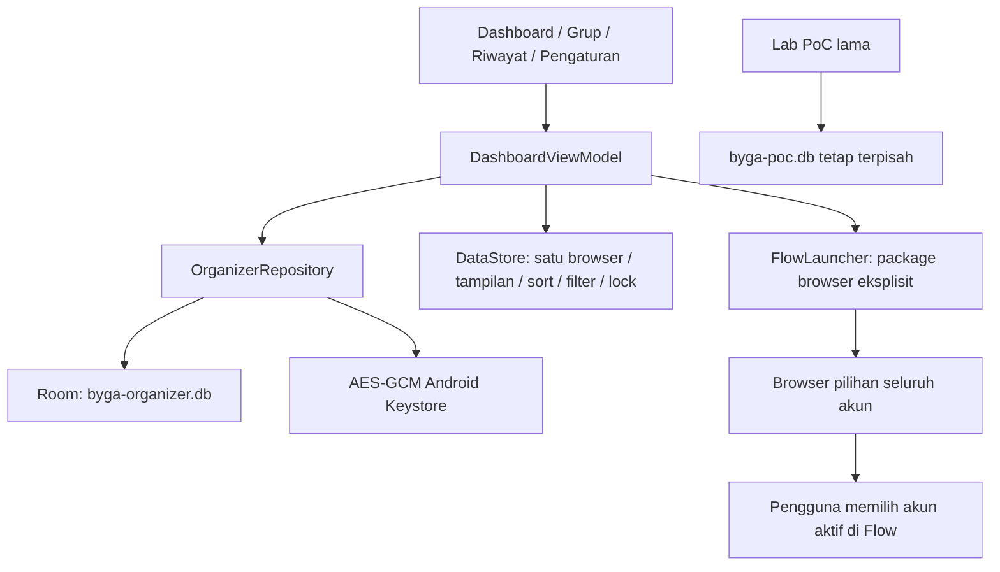

# Arsitektur organizer satu browser

Scope aktif: [scope-manual-switching.md](scope-manual-switching.md), disetujui pengguna dengan “satu browser saja”. Kotlin, Compose Material 3, MVVM, Room, DataStore, Android Keystore, min API31, package com.byga.flowmanager. Tidak ada backend.

## Data

managed_accounts: UUID, payload email/alias/catatan terenkripsi, groupId, favorite, color, timestamps. managed_groups: UUID dan nama terenkripsi. managed_launches: snapshot target terenkripsi, accountId, provider/version, timestamp, outcome, pengamatan terenkripsi dan waktu konfirmasi. Foreign key grup SET NULL saat grup dihapus; akun CASCADE riwayat saat metadata akun dihapus. Payload AES-GCM diikat dengan AAD field/ID. Semua enkripsi/dekripsi dan database berada pada IO dispatcher.

Deduplikasi email dilakukan dalam transaksi Room atas email ternormalisasi (tanpa menghapus dot/plus). Upsert mempertahankan lastOpenedAt/createdAt saat edit. Impor melakukan recheck duplikat saat commit dan transaksi atomik, sehingga perubahan dashboard selama preview tidak menyebabkan overwrite. Snapshot launch tidak berubah ketika metadata akun diedit. Snapshot identitas target yang sudah berubah ditolak sebelum dispatch.

## Launch dan status

Browser disimpan sekali pada DataStore, berlaku untuk seluruh akun. UI menampilkan target dan instruksi pemilihan akun manual sebelum dispatch. ACTION_VIEW hanya URL HTTPS Flow, package browser eksplisit, tanpa email/authuser/token/cookie. Provider hilang/ditolak menjadi BLOCKED/FAILED, tanpa fallback.

STARTING disimpan sebelum dispatch; dispatch berhasil hanya UNVERIFIED. lastOpenedAt berubah hanya jika dispatch berhasil, bukan bukti akun login. Pembukaan baru menjadikan pending lama ABANDONED. Hanya pending terbaru dapat dikonfirmasi. Input email aktual menjadi VERIFIED_MANUAL atau MISMATCH; login prompt, expiry yang dilaporkan jelas, dan UNKNOWN terpisah. UI selalu melabeli hasil sebagai historis. Tidak ada penentuan expiry berdasarkan waktu.

## UI dan preferensi

Dashboard menampilkan avatar inisial/warna, alias/email/grup, favorit, pencarian, sorting, list/grid responsif dan aksi massal. Filter grup, sorting dan mode tampilan dipulihkan melalui DataStore; ini pemulihan workspace lokal, bukan proyek Flow. Account picker Android memperoleh metadata dengan persetujuan pengguna melalui official chooser, tanpa GET_ACCOUNTS atau Google OAuth token.

Impor memakai Storage Access Framework, UTF-8 ketat, maksimal2 MB/5.000 baris. CSV parser defensif, header whitelist, preview dan daftar line/reason tanpa raw invalid content. Ekspor CSV hanya email/alias/grup dengan formula neutralization dan konfirmasi plaintext metadata. Favorit/catatan/warna/history tidak dicakup ekspor CSV ini.

SecureBygaActivity melindungi dashboard dan Lab dengan preferensi kunci yang sama. BiometricPrompt memakai biometrik kuat atau credential perangkat; autentikasi diperlukan sebelum mengaktifkan kunci, dan state unlock berada di memori. App ditinggalkan → lock; setelah kembali dari browser/SAF perlu unlock jika aktif. Tidak menyimpan PIN/password sendiri.

## Upgrade

Versi0.2.0 memakai database organizer baru versi1. Database PoC versi1 dan key alias lama dipertahankan agar metadata lama dapat dibaca. Key generation disinkronkan lintas instance untuk mencegah penggantian key pada startup bersamaan. Lab dapat dibuka melalui Pengaturan; penyalinan metadata PoC ke dashboard melalui preview/konfirmasi eksplisit dan deduplikasi. Tidak memigrasikan konfirmasi PoC menjadi bukti sesi baru.

Arsitektur Phase0 terdahulu: [phase0-architecture.md](phase0-architecture.md). Gate isolasi tetap UNVERIFIED, bukan blocker organizer manual yang telah disetujui. Produksi tidak dipublikasikan otomatis.
