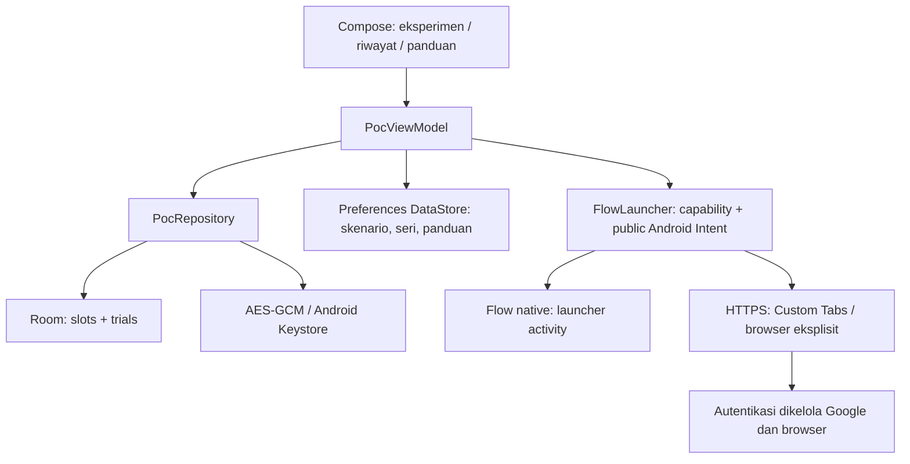

# Arsitektur Phase 0

Status produk: **UNVERIFIED**, bukan implementasi penuh PRD. Package `com.byga.flowmanager`, Android 12/API 31+, Kotlin, Compose Material 3, MVVM. Tidak ada backend.

## Batas fase

Tiga slot A/B/C adalah target identitas untuk percobaan. Menyimpan email tidak menambah akun Google, membuat sesi, atau melakukan login. Dashboard lengkap, importer, account picker, grup, favorit, workspace dan PIN/biometrik ditunda sampai GO sesuai PRD §13–14; tidak ada tombol placeholder fitur tersebut.

## Peluncuran dan identitas

1. Tester menyimpan email serta rute/provider per slot. Email divalidasi dan duplikat identik dicegah tanpa menghapus titik atau plus-addressing.
2. Dialog menjelaskan bahwa akun sebenarnya bisa berbeda. Email target tidak dikirim melalui Intent atau URL.
3. Repository menyimpan snapshot immutable identitas target, provider/version, profil, skenario, run ID, timestamp. Pending lama menjadi `ABANDONED` dalam transaksi yang sama.
4. `STARTING` disimpan sebelum peluncuran. Dispatch berhasil hanya menghasilkan `UNVERIFIED`; provider hilang `BLOCKED`; aktivitas/policy menolak `FAILED`. Tidak ada fallback diam-diam.
5. Tester kembali, melihat akun aktif di Flow, lalu mengetik email yang benar-benar terlihat. Hanya pending terbaru dapat direview. Email berbeda menghasilkan `MISMATCH`. Login prompt, pesan sesi habis, atau tidak dapat diperiksa disimpan terpisah.
6. Konfirmasi manual hanya bukti historis satu pembukaan. UI selalu mengatakan sesi sekarang belum diketahui. Restart tidak mengubah riwayat menjadi bukti sesi baru. Proses mati ketika dispatch berlangsung meninggalkan `STARTING` yang jujur sebagai hasil belum diketahui; pembukaan baru menggantikannya.

`VERIFIED_AUTOMATED` tidak diimplementasikan. Gate UI dan laporan ekspor selalu UNVERIFIED sampai bukti eksternal ditinjau; jumlah konfirmasi cocok tidak menaikkan gate otomatis.

## Rute

- Native: package dari referensi Google Play `com.google.android.apps.labs.whisk`, melalui `PackageManager.getLaunchIntentForPackage`. Membuka layar utama tanpa extra akun atau deep link privat. Kehadiran package tidak dianggap bukti tanda tangan publisher; install dari Play resmi.
- Custom Tabs: hanya browser yang mengekspos layanan Custom Tabs. Provider dipin dengan `setPackage`. Tidak menggunakan ephemeral/incognito sebagai solusi persisten.
- Browser: HTTPS `https://labs.google/fx/tools/flow`, provider eksplisit yang dipilih tester; redirect/navigasi selanjutnya dimiliki browser/Google.
- Work Profile: hanya dari salinan BYGA yang sudah berjalan di managed profile. Tidak provisioning profil, menjadi device owner, meminta privileged permission, atau menyeberang profil otomatis. Profil kerja menguji browser pada profil saat ini; native dari profil kerja dapat diuji dengan rute native. Dua profil tidak membuktikan A/B/C independen.

## Persistensi dan kegagalan

Room menyimpan konfigurasi tiga slot dan semua percobaan. Email target/terlihat dienkripsi per nilai dengan Android Keystore AES-256-GCM, IV acak, dan AAD berbeda per record/field. Metadata diagnostik lainnya tetap plaintext di sandbox Android. DataStore menyimpan preferensi nonrahasia. IO dan crypto dilakukan di dispatcher IO; penulisan bukti atomik lewat transaksi Room. Tidak ada destructive migration otomatis.

Kegagalan storage, crypto, provider, dan ekspor dilaporkan dengan pesan aman tanpa exception berisi PII. Keystore tidak tersedia/rusak tidak menyebabkan fallback plaintext. Metadata dapat dihapus melalui Pengaturan Android bila kunci hilang. UI menampilkan loading, empty, busy, pending, dan error snackbar. Room schema version 1 diekspor untuk review.

## Toolchain terkunci

Gradle 8.11.1 (wrapper SHA-256), AGP 8.9.2, Kotlin 2.1.20, KSP 2.1.20-1.0.32, Compose BOM 2025.04.01, Room 2.7.1, DataStore 1.1.4, Browser 1.8.0. Versi stabil dipin; bukan klaim bahwa versi tersebut paling baru. compile/target SDK 35, source/target JVM 17; CI JDK 17.
